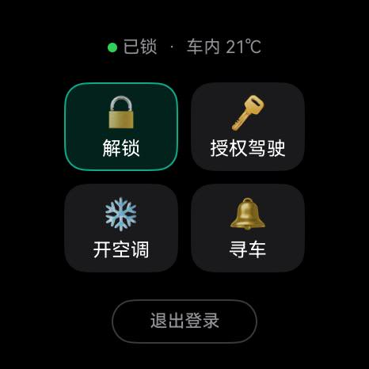
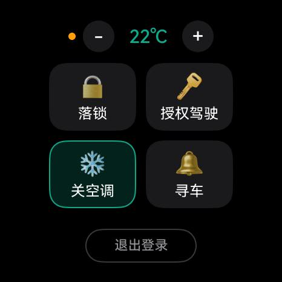

# 理想汽车鸿蒙手表端车控 App（Lixiang HM Watch）

[](LICENSE)
[](#平台与设备)
[](#平台与设备)

> [!WARNING]
> **本项目是非官方第三方实现，与理想汽车（Li Auto）无任何关联。**
> 使用的是理想汽车 App 的私有接口，服务端随时可能变更导致失效；
> 车控操作有真实物理后果，请自行评估风险。详见 [免责声明](#免责声明)。

<p align="center">
  
  
</p>

---

## 项目简介

**项目名称**：理想汽车鸿蒙手表端车控 App（英文标识 `Lixiang HM Watch`，仓库名 `lixiang-hm-watch`）

**包名**：`com.kylin.lixianghmwatch`

**一句话定位**：一款**为 HarmonyOS 7 智能手表端**开发的原生应用，让理想汽车车主
**抬手就能控制车辆** —— 解闭车锁、授权驾驶、开关空调、寻车，全部在 466×466 的圆形表盘上完成。

这是一款**手表独立 App**，不是手机的伴侣/遥控界面：手表自己完成登录、签名与指令下发，
不需要手机在旁边，也不需要 Home Assistant 之类的家庭服务器中转。
为此项目把官方 App 的完整协议链路（PAKE 登录 → 设备身份派生 → 双 token 换取 →
带签名的车控指令 → VSS 状态读取）全部移植进了 ArkTS，并附带一套 Python 对拍工具。

### 平台与设备

| 项 | 说明 |
|---|---|
| **目标平台** | HarmonyOS 7（`compatibleSdkVersion` / `targetSdkVersion` = `26.0.0`） |
| **设备类型** | 智能手表（`deviceTypes: ["wearable"]`），仅手表，不适配手机 / 平板 / TV |
| **已验证机型** | 华为 Watch 6（NIZ-AL00），466×466 圆屏，实机装机验证 |
| **屏幕适配** | 按 466×466 圆屏做像素级布局预算；其他尺寸的圆屏**未经验证**，方屏不支持 |
| **交互形态** | 全触摸、单页无滚动（内容超出时兜底滚动），不使用旋转表冠 |
| **网络要求** | 手表需通过 Wi-Fi 或蜂窝（eSIM）**独立联网**，无需蓝牙连接手机 |
| **权限** | `ohos.permission.INTERNET`、`ohos.permission.GET_NETWORK_INFO`（仅此两项） |

> 使用门槛：需要**自己的理想汽车账号 + 自己在华为开发者账号下签名**。
> 本项目不提供现成安装包，也不收集、不上传任何账号信息。

## 功能

| 功能 | 说明 |
|---|---|
| **解闭车锁** | 主驾门锁开/关，实测响应 0.5–1.5 s |
| **授权驾驶** | 生成临时授权，供他人临时用车 |
| **开关空调** | 开关 + 16–28 ℃ 调温；解锁车辆时空调常会自动开启，界面会自动切到调温态 |
| **寻车** | 鸣笛 / 闪灯定位 |
| **退出登录** | 二次确认弹窗，清除本地凭据并回到登录页 |

界面面向普通用户，不显示任何协议名、错误码或自检信息；技术细节只写进 hilog。

> 解锁车辆时车辆通常会自动开启空调，因此界面把「调温」直接并入顶部状态行，
> 保证「状态 + 四个功能 + 调温」在同一屏内可见，无需滑动。

## 开发环境

运行侧要求（系统版本、设备类型、权限）见上文 [平台与设备](#平台与设备)；本节只列**开发机**需要装什么。

| 项 | 版本 / 说明 |
|---|---|
| 开发工具 | DevEco Studio（含 HarmonyOS SDK API 26、hvigor、jbr） |
| 目标 API | `compatibleSdkVersion` / `targetSdkVersion` = `26.0.0` |
| 语言 | ArkTS（严格模式），无三方运行时依赖 |
| 验证工具（可选） | Python 3.10+（`cryptography` / `bcrypt` / `pynacl` / `requests`） |
| 华为开发者账号 | 必需 —— 真机安装要自己生成调试签名，见 [配置签名](#3-配置签名必做否则装不进真机) |

## 目录结构

```
.
├── LixiangWatch/                    DevEco 工程（用 DevEco Studio 打开这一层）
│   ├── AppScope/app.json5           包名、版本、API 版本
│   ├── entry/src/main/
│   │   ├── module.json5             deviceTypes: wearable
│   │   └── ets/
│   │       ├── pages/Index.ets      ★ 全部界面（登录 / 车控 / 弹窗）
│   │       ├── common/AppState.ets  凭据管理、静默续期、客户端装配
│   │       ├── core/protocol/       PAKE 登录、签名、身份派生、双 token
│   │       ├── core/control/        车控指令 + VSS 状态读取
│   │       └── core/crypto/         密码学（系统通道 + 纯 ArkTS 实现）
│   └── signature/README.md          签名材料说明（证书本体不入库）
├── verify_tool/                     Python 协议验证工具（跑通后再移植到手表）
├── scripts/                         构建 / 真机连接辅助脚本
└── docs/
    ├── DEVELOPMENT.md               开发手记：协议细节与踩坑记录
    └── screenshots/
```

约 1.17 万行（ArkTS + Python）。

## 快速开始

### 1. 克隆与准备

```bash
git clone https://github.com/Kylin12138/lixiang-hm-watch.git
cd lixiang-hm-watch
cp scripts/local.env.example scripts/local.env   # 填入本机 DevEco 路径与手表 IP
```

### 2. 打开工程

DevEco Studio → `File > Open` → 选择 **`LixiangWatch`** 目录（不是仓库根目录）。

### 3. 配置签名（必做，否则装不进真机）

`build-profile.json5` 里的 `signingConfigs` 是**故意留空**的 —— 签名材料等同应用身份，不能入库。

> `File > Project Structure > Project > Signing Configs` → 勾选
> **Automatically generate signature** → 登录华为开发者账号，DevEco 会自动回填。

详情见 [`LixiangWatch/signature/README.md`](LixiangWatch/signature/README.md)。

### 4. 构建

```bash
source scripts/env.sh      # 自动探测 DevEco Studio 路径，导出 lxbuild / lxclean
lxbuild                    # 产物：entry/build/default/outputs/default/*.hap
```

命令行构建产出的是 **unsigned HAP**；要装真机请在 DevEco 里直接 Run，或用
`hvigorw assembleHap` 配合已配置的 `signingConfigs`。

### 5. 安装到手表

```bash
# USB
hdc install -r entry-default-signed.hap

# 无线调试（需先在手表开发者选项里开启，端口每次重连都会变）
source scripts/lxconn.sh   # 自动探测端口，并把熄屏时间延长到 30 分钟
hdc -t "$LX_T" install -r entry-default-signed.hap
```

## 使用说明

1. **首次登录**：打开应用 → 输入理想汽车账号手机号 + 密码 → 登录。
   新设备首次登录时服务端可能要求短信验证，完成一次后同一 `device_id` 免验证。
2. **主界面**：顶部一行显示车辆状态（`● 已锁 · 车内 21℃`）。
   解锁后空调常会自动开启，此时顶部自动切换为调温条 `● − 22℃ +`，点 `+/-` 可调 16–28 ℃。
3. **功能卡**：宫格四个方块对应四个功能，点击即下发；执行中会转圈，完成后自动刷新状态。
4. **退出登录**：底部按钮 → 二次确认 → 清除本地凭据并回到登录页。

> 车控指令是**异步**的：点击后界面先进入乐观态，再通过轮询 `cmd/send` 结果确认，
> 因此偶尔会看到「指令已发出，车辆暂未反馈」这类提示，属正常降级。

## 协议验证工具（可选，但强烈建议）

手表端调试成本极高（装包慢、日志难抓、无断点）。`verify_tool/` 用 Python 把**完全相同的协议**
在电脑上先跑通，验证签名、身份派生与指令参数；跑通后 ArkTS 只是机械翻译。

```bash
cd verify_tool
pip install cryptography bcrypt pynacl requests

python test_offline.py            # 30 项离线单测，不联网
python lx_main.py login           # 首次需手机浏览器完成滑动 + 短信
python lx_main.py keysuite        # 派生设备身份
python lx_main.py vehicles        # 只读：确认 VIN
python lx_main.py state           # 只读：拉 VSS 实时状态
python lx_main.py lock            # ★ 真车会动
```

账号信息一律通过环境变量 / `cred.json` 传入，**仓库内不含任何真实账号**：

```bash
cp cred.example.json cred.json    # cred.json 已被 .gitignore 忽略
```

## 关键技术点

- **密码学双通道**：优先用 HarmonyOS 系统 `cryptoFramework`，不可用时自动降级到
  `core/crypto/pure/` 里纯 ArkTS 实现的 SHA / HMAC / AES / RSA / Ed25519 与 bcrypt 移植版。
  两条通道逐字节对拍，桩环境（Previewer）也能完整跑协议。
- **重计算必须进 taskpool**：手表上完整登录签名约 20 s、解锁签名约 5 s，
  放主线程会触发 `THREAD_BLOCK_6S` 被系统 `SIG 9` 强杀。
- **双 token 不能互顶**：MESH 与 VSS 必须复用同一 audience 的 token，单独换会导致会话被顶掉。
- **Cookie 父域**：换 scope token 时必须带上 `.lixiang.com` 父域 cookie，否则恒返回 `login_required`。
- **466 px 纵向预算**：`FlexAlign.SpaceBetween` 在内容总和超容器时会退化成紧排并互相压盖，
  布局必须按「总高度 ≤ 可用高度」静态核算，不能靠调 margin 救。
- **熄屏不等于退出**：手表熄屏/亮屏都不触发 `onPageShow`，页面保活靠前台定时轮询自愈。

更多踩坑记录见 [`docs/DEVELOPMENT.md`](docs/DEVELOPMENT.md)。

## 安全说明

以下内容**永远不要提交**（`.gitignore` 已默认忽略）：

| 文件 | 为什么 |
|---|---|
| `verify_tool/cred.json` | 含 refresh_token / bearer / hac_key，等同车辆控制权 |
| `LixiangWatch/signature/*` | 签名证书与 Profile，等同应用身份 |
| `scripts/local.env` | 本机路径与手表内网 IP |

`build-profile.json5` 里的 `signingConfigs` 保持为空数组，请勿把 DevEco 回填的内容提交上来。

如果你在 fork 里不小心提交了上述内容，请立即：撤销对应账号的登录态（改密码 / 在 App 里踢设备）、
重新签发证书，然后用 `git filter-repo` 清理历史 —— 仅删除最新提交是不够的。

## 贡献

欢迎提交 Issue 与 PR，请先读 [CONTRIBUTING.md](CONTRIBUTING.md) 与
[CODE_OF_CONDUCT.md](CODE_OF_CONDUCT.md)。

## 免责声明

本项目为个人学习与自用目的开发的**非官方**客户端，与理想汽车及其关联公司无任何关系，
未获得其授权或认可。使用本软件即表示你理解并同意：

1. 所有车控操作由你本人发起并承担全部后果，包括但不限于车辆状态异常、误操作、账号被风控；
2. 项目作者不对任何直接或间接损失负责；
3. 请勿用于商业用途，请勿大规模调用官方接口；
4. 若官方提出异议，项目将立即停止维护。

应用图标中的「理想汽车」标识为其权利人所拥有的商标，此处仅用于标识本应用所连接的车辆品牌，
不代表任何形式的授权、合作或背书。若权利人要求，将立即替换。

## 许可证

[MIT](LICENSE) © 2026 Kylin12138

## 致谢

- [C3H3-AI/ha-lixiang](https://github.com/C3H3-AI/ha-lixiang) —— 协议逆向的关键参考实现
- 理想汽车 App 的公开接口文档缺失，本项目所有协议细节均来自对客户端行为的观察与分析
